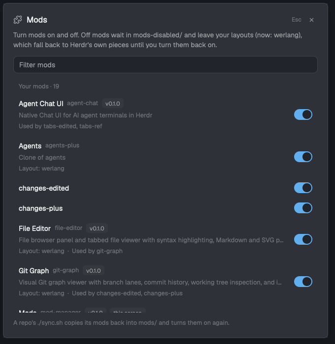

# Herdr Mod Manager

A **Mods** settings screen for Herdr: every installed mod with an on/off switch, a **Browse** tab for the mods people share on [herdr.dev/mods](https://herdr.dev/gallery/?type=mods), and updates for the ones you installed from there. Turning a mod off takes it out of your layouts (they fall back to Herdr's own pieces) and parks its folder; turning it on puts everything back.



## What it shows

- **Your mods** — every folder in `~/.config/herdr-app/mods/` that Herdr didn't ship, plus the ones you turned off. Each row has the title, folder, version and description from `mod.json`, and where the mod is used:
  - `Layout: …` — personal layouts that place it;
  - `Used by …` — other mods whose code names it (an overlay they open, a presence check);
  - `Keys: …` — bindings in `keys.json` that run its commands.
- **Herdr's mods** (collapsed) — shipped mods, listed but locked: Herdr restores them on every start.
- Under a mod installed from herdr.dev: `From owner/repo`, with **Update** when the listing has a newer commit, and **Unlink**. A mod with the same folder name as a listing gets a dim **Link to herdr.dev…**; it asks which listing (names alone can't tell, since authors reuse them).
- A trash icon next to each of your mods' switches deletes it (asks first). It's taken out of your layouts like turning it off, then its folder goes to the system Trash (Finder as a fallback on macOS; `gio trash` or a plain delete on Linux). Its install record goes too; its key bindings stay.
- **Browse**: the herdr.dev mods index, sorted by stars or by last push, filtered by the same box. Each row has a GitHub icon, then **Install** or **Update**. Click a listing for its preview and folders; click the preview to see it full size (click or Esc closes).
- A filter box, and Esc / × to close.

## How it behaves

Turning a mod **off**:

1. In each personal layout (`layouts/*.json`, not Herdr's shipped ones) that uses it:
   - a block switches to the mod it was cloned from (`cloned_from` in `mod.json`), else to the shipped mod named like the block (`files`, `changes`), else it is hidden;
   - a stack header goes back to the plain `tabs` strip; a pane header is removed;
   - a custom `terminal_menu` is removed, so Herdr's `menu` is used.
2. The folder moves to `~/.config/herdr-app/mods-disabled/<name>`. Herdr only loads `mods/`.
3. What changed is recorded in `mods-disabled/.mod-manager.json`.

Turning it **on** moves the folder back and undoes exactly those layout changes. If you changed a block yourself meanwhile, your change is kept.

Herdr redraws from the files within a second, so the switch applies live.

**Installing** from Browse downloads the repo at the listed commit (`curl` + `tar`), then asks first, showing:

- what its code reaches: network, programs (`exec`/`hc`), files outside its own folder;
- the folders it adds. A taken name gets a free one (`name-2`), with its `mods/<name>/` asset paths, self-opening overlays and key commands renamed;
- the keys from its `keys.json` it adds. A key you already use is never replaced; the prompt says which ones were kept.

After `herdr-app check` passes, the install is recorded in `mods-disabled/.mod-manager-sources.json` (listing and commit).

**Updating** happens when the listing's commit differs from the recorded one. It downloads the new commit and asks:

- **Replace**: your folder is swapped for the new one. The old one is kept as `mods-disabled/<name>.old-<time>`, and if the new one fails `herdr-app check`, yours is put back.
- **Keep mine as a clone**: `mod.clone` saves your copy as `<name>-mine` first, then replaces.
- **Cancel**.

**When it checks**: the index is cached in `mods-disabled/.mod-manager-cache/index.json` and shown right away. It is fetched again when the screen opens, on the refresh button, and once a day by `usage-status` (whose puzzle icon then shows the update count). The count lives in `mods-disabled/.mod-manager-updates.json`.

## Requirements

- Herdr app 0.1.13 or newer.
- macOS or Linux (folders are moved with `mv`; downloads use `curl` and `tar`).

## Install

Copy/sync `mods/mod-manager` into `~/.config/herdr-app/mods/`, then bind a key (merge `keys.json` from this repo into yours):

```json
{ "global": { "cmd-shift-,": "mod.open:mod-manager" } }
```

With [`usage-status`](https://github.com/werlang/herdr-usage-status) in your status bar, a puzzle icon there opens it too (it appears by itself once this mod is installed), and shows how many updates are waiting.

Or open it once with:

```sh
herdr-app do mod.open --name mod-manager
```

## Watch out

- Herdr's Settings window can't be extended by mods, so **Mods** is its own settings-style dialog, one key next to Settings (`cmd-,` / `cmd-shift-,`).
- A mod's own repo `sync.sh` copies it back into `mods/`, turning it on again. If both a parked copy and a fresh one exist, the fresh one wins and the parked copy is kept as `<name>.old-<time>`.
- Key bindings to an off mod's commands stay in `keys.json`; they do nothing until it's on again.
- Mods that open an off mod (for example a menu opening another mod's dialog) can't open it while it's off; the row lists them under `Used by`.
- The manager can't turn itself off.
- Mods run as you, unsandboxed. The install prompt's notes come from reading the code (a pattern search), not a review.
- Updates are offered only for mods that are on. Mods you develop locally and sync with `sync.sh` shouldn't be linked, or an update and the sync will overwrite each other.
- An update replaces files but doesn't merge new keys from the mod's `keys.json`.
- Backups from updates (`mods-disabled/<name>.old-<time>`) aren't cleaned up automatically.

## Repository

```sh
./sync.sh          # copy to the live Herdr folder and run herdr-app check
node --test test/  # unit tests of the layout and catalog logic
```

## Publish

App-mod repo: `mods/mod-manager` at the root, `RECIPE.md`, `preview.png`, topic `herdr-mod`. See `.agents/skills/herdr-publish/`.
