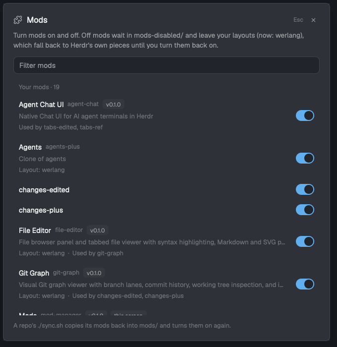

# Mod Manager

A **Mods** settings screen: every installed Herdr mod with an on/off switch. Off mods leave your layouts, which fall back to Herdr's own pieces, and come back exactly where they were.

## What you see

`cmd-shift-,` (next to Settings' `cmd-,`) opens a dialog titled **Mods**:

- A filter box.
- **Your mods**: one row per mod you installed or cloned, with title, folder, version, description, and where it's used (`Layout: werlang`, `Used by spaces-plus`, `Keys: cmd-w`). A switch on the right; off rows are muted and tagged `off`.
- **Herdr's mods** (collapsed): the shipped mods, with locked switches.

## How it behaves

- Off: personal layouts that use the mod switch that block to the mod it was cloned from (or the shipped mod named like the block), else hide it; a custom terminal menu goes back to Herdr's. Then the folder moves to `~/.config/herdr-app/mods-disabled/`. Changes are recorded in `mods-disabled/.mod-manager.json`.
- On: the folder moves back and the recorded layout changes are undone, unless you changed that spot yourself meanwhile.
- Applies live; a toast confirms each switch.
- Shipped layouts and shipped mods are never edited.

## Built from

- A new mod, `mods/mod-manager`: `main.js` (the dialog) and `manager.js` (pure layout logic: find references, fall back, restore; unit-tested with `node --test`).
- `herdr` APIs: `appHome`, `exec` (`mv`), `fs/promises` (`readdir`, `readFile`, `writeFile`, `mkdir`, `exists`), `theme`, `shared("layout")`, `notify`, `props`/`closeOverlay`.
- `mod.json` declares it as a 600×620 dialog, so `mod.open mod-manager` opens it.
- Icons: a puzzle glyph, and copies of `workspace-chrome`'s x, chevrons and spinner.

## Watch out

- Herdr's Settings window can't take mod sections; this is a separate settings-style dialog.
- Re-running a repo's `sync.sh` turns its mods back on.
- Bindings to an off mod's commands stay in `keys.json` and do nothing while it's off.
- macOS/Linux only (`mv`).

## Done when

- `herdr-app check` passes for `mods/mod-manager`.
- `cmd-shift-,` opens the dialog; Esc closes it.
- Turning a mod placed in your layout off swaps the block to its fallback and moves the folder to `mods-disabled/`; turning it on restores both.
- `herdr-app status` reports no errors.
